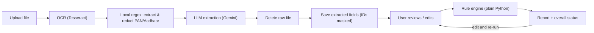
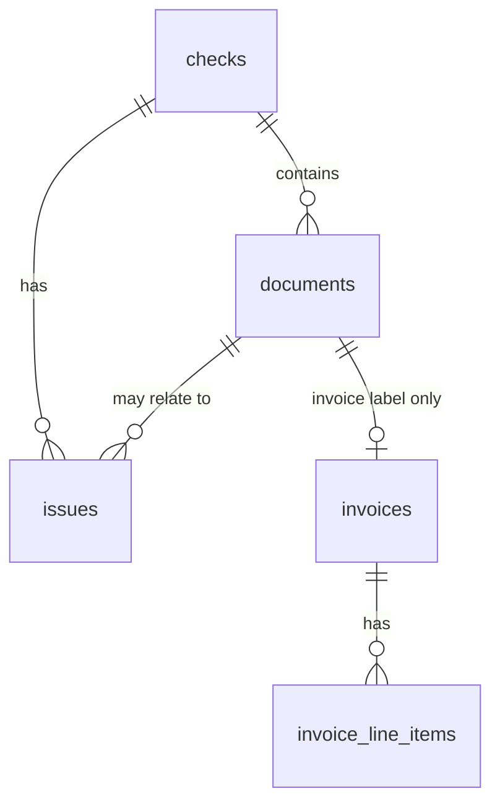

# VerifyFlow: Design Document (v1)

This document turns [PRD.md](./PRD.md) into a concrete design. It covers the data model, API, extraction fields, validation rules, folder structure, and screens for the MVP. No code yet.

---

## 1. Core Concepts

| Term | Meaning |
|---|---|
| **Check** | One verification job. Has a type (`invoice` or `kyc`). An invoice check can hold one or more invoice files. A KYC check is one "case" (one person) with several labelled files. |
| **Document** | One uploaded file inside a check, with a label (e.g. `invoice`, `pan`, `aadhaar`). The raw file is deleted right after extraction. Only extracted fields are kept. |
| **Extracted fields** | Structured values pulled out by OCR + LLM. The user can edit them. |
| **Issue** | One problem found by a validation rule: rule code, severity, message, suggested fix. |
| **Report** | All issues for a check plus the overall status (Pass / Needs review / Fail). |

### Pipeline



### Check status lifecycle

`draft` (created, files being added) → `extracted` (all files extracted, awaiting review) → `validated` (report available). Editing a field after validation sets status back to `extracted` and marks the report as stale until re-validated.

---

## 2. Database Schema (PostgreSQL)

All primary keys are UUIDs. All tables have `created_at` and `updated_at` (timestamptz).

### 2.1 `checks`

| Column | Type | Notes |
|---|---|---|
| id | uuid PK | |
| doc_type | enum(`invoice`, `kyc`) | |
| status | enum(`draft`, `extracted`, `validated`) | |
| overall_status | enum(`pass`, `needs_review`, `fail`) NULL | Set after validation |
| report_stale | boolean default false | True if fields were edited after the last validation |
| validated_at | timestamptz NULL | |

### 2.2 `documents`

| Column | Type | Notes |
|---|---|---|
| id | uuid PK | |
| check_id | uuid FK → checks (cascade delete) | |
| label | enum(`invoice`, `pan`, `aadhaar`, `address_proof`, `passport`, `driving_licence`, `selfie`) | Set by user for KYC; always `invoice` for invoice checks |
| original_filename | text | Kept for display only |
| mime_type | text | `application/pdf`, `image/jpeg`, `image/png` |
| page_count | int | |
| extraction_status | enum(`pending`, `done`, `failed`) | |
| extraction_error | text NULL | |
| ocr_engine | text | e.g. `tesseract-5` |
| ocr_confidence | numeric(5,2) NULL | Mean word confidence, 0–100 |
| readability | jsonb | `{ "width", "height", "blur_score", "brightness", "readable": bool }` |
| fields | jsonb NULL | **KYC only.** Extracted values (shape depends on label, see Section 4.2). Sensitive IDs stored masked. `NULL` for invoice documents (`invoices` and `invoice_line_items` are the source of truth for invoices) |
| field_meta | jsonb | Per field: `{ "confidence", "edited": bool, "source": "regex" \| "llm" \| "user" }` |
| id_format_valid | boolean NULL | KYC only. Result of the format/checksum check on the ID number, computed before masking. For masked Aadhaar (`XXXX-XXXX-1234`), `true` if the last 4 digits are valid (checksum skipped) |
| id_hash | text NULL | KYC only (optional). `HMAC-SHA256(ID_HASH_SECRET, full_id)` using a secret key from `.env`, computed before masking so duplicate/matching ID checks can run without storing the raw number. `NULL` when the uploaded Aadhaar is already masked |

> The raw file and the full OCR text are **never** written to the database or disk long-term. The file sits in a temp folder only during extraction and is deleted in a `finally` block.

### 2.3 `invoices`

The `invoices` and `invoice_line_items` tables are the **single source of truth** for invoice extracted fields and user edits (invoice fields are not duplicated in `documents.fields`). Typed columns allow indexing and SQL duplicate lookups. One row per invoice document.

| Column | Type | Notes |
|---|---|---|
| id | uuid PK | |
| check_id | uuid FK → checks (cascade delete) | |
| document_id | uuid FK → documents (unique, cascade delete) | |
| invoice_number | text NULL | Normalised (trimmed, uppercased) for matching |
| invoice_date | date NULL | |
| due_date | date NULL | |
| vendor_name | text NULL | |
| vendor_gstin | text NULL | Normalised uppercase |
| vendor_address | text NULL | |
| buyer_name | text NULL | |
| buyer_gstin | text NULL | |
| place_of_supply | text NULL | State name or 2-digit state code |
| currency | text default `INR` | |
| subtotal | numeric(14,2) NULL | Taxable value |
| cgst_amount | numeric(14,2) NULL | |
| sgst_amount | numeric(14,2) NULL | |
| igst_amount | numeric(14,2) NULL | |
| total_tax | numeric(14,2) NULL | |
| total | numeric(14,2) NULL | Grand total |

**Index:** `(invoice_number, vendor_gstin)`. This is deliberately **not** a unique index, because duplicates have to be saved so they can be reported.

### 2.4 `invoice_line_items`

| Column | Type | Notes |
|---|---|---|
| id | uuid PK | |
| invoice_id | uuid FK → invoices (cascade) | |
| position | int | Row order |
| description | text | |
| hsn_sac | text NULL | |
| quantity | numeric(14,3) NULL | |
| unit_price | numeric(14,2) NULL | |
| tax_rate | numeric(5,2) NULL | Percent, e.g. 18.00 |
| amount | numeric(14,2) NULL | Taxable amount for the line |

### 2.5 `issues`

All issues for a check are replaced on every validation run.

| Column | Type | Notes |
|---|---|---|
| id | uuid PK | |
| check_id | uuid FK → checks (cascade) | |
| document_id | uuid FK NULL | NULL for check-level issues (e.g. "PAN missing") |
| rule_code | text | e.g. `INV-MATH-003` |
| severity | enum(`high`, `medium`, `low`) | |
| field | text NULL | Field path, e.g. `total` or `line_items[2].amount` |
| message | text | Plain-language reason |
| suggested_fix | text | Plain-language fix |
| details | jsonb | Numbers behind the issue, e.g. `{ "expected": 1180.00, "found": 1108.00 }` |

### 2.6 Relationships



### 2.7 Data handling

- **Local regex extraction & LLM redaction:** PAN and Aadhaar numbers are extracted from the OCR text using local regexes and redacted (`[REDACTED_PAN]`, `[REDACTED_AADHAAR]`) **before** the OCR text is sent to the LLM. The LLM never receives raw PAN or Aadhaar numbers.
- **Masking:** IDs are stored in `documents.fields` with only the **last 4 characters visible**: PAN `******234F`, Aadhaar `XXXX-XXXX-1234`, passport/DL `******1234`.
- **Masked Aadhaar support:** If the uploaded Aadhaar card is already masked on the document (e.g. `XXXX-XXXX-1234` or `********1234`), the starting-digit and Verhoeff checksum checks are skipped, `id_format_valid` is set to `true` (provided the last 4 characters are digits), `id_hash` is left `NULL`, and no validation issue is raised.
- **Format checks & HMAC before masking:** The full ID only exists in memory during local extraction or user edit. Format/checksum validation runs in memory and sets `id_format_valid`. When a full ID is present, `id_hash` is computed as `HMAC-SHA256(ID_HASH_SECRET, full_id)` using a secret key from `.env` (never plain or unsalted SHA-256, because the 12-digit Aadhaar keyspace is small enough to brute-force).
- **Editing an ID:** The user re-types the full number (or masked Aadhaar). It is validated, HMAC-hashed (if unmasked), and masked in memory; the raw input is discarded.
- **Invoices:** `invoices` and `invoice_line_items` are the sole source of truth for invoice fields (`documents.fields` is `NULL` for invoices). GSTIN and invoice data are business data, not personal IDs, so they are stored in full (needed for duplicate detection).
- **Retention:** Invoice rows are kept for duplicate detection (`INV-DUP-001`). KYC checks and their cascaded documents/issues are auto-deleted after a configurable number of days (`KYC_RETENTION_DAYS` in `.env`, default `7`).

---

## 3. API Endpoints (FastAPI, prefix `/api`)

There is no authentication in the MVP (local use with synthetic sample documents only). **Authentication is required before any public deployment.** Request and response bodies are JSON unless marked multipart.

| Method | Path | Purpose |
|---|---|---|
| GET | `/health` | Liveness check. Also reports which OCR and LLM providers are configured |
| POST | `/checks` | Create a check. Body: `{ "doc_type": "invoice" or "kyc" }` |
| GET | `/checks` | List recent checks (id, type, status, overall_status, created_at). Feeds the nice-to-have history screen |
| GET | `/checks/{check_id}` | Full check: documents, extracted fields (from `invoices`/`invoice_line_items` for invoices, or masked `documents.fields` for KYC), status |
| DELETE | `/checks/{check_id}` | Delete a check and all its data |
| POST | `/checks/{check_id}/documents` | **Multipart.** Fields: `file`, `label`. Runs OCR + local ID regex/redaction + LLM extraction synchronously, deletes the file, returns the document with extracted fields |
| PATCH | `/checks/{check_id}/documents/{document_id}` | Edit extracted fields. Body: `{ "fields": { ... } }`. Updates `invoices` + `invoice_line_items` for invoices, or `documents.fields` for KYC. Sets `report_stale = true` |
| PUT | `/checks/{check_id}/documents/{document_id}/label` | Change a KYC file label (fields are re-mapped; re-extraction may be needed) |
| POST | `/checks/{check_id}/documents/{document_id}/reextract` | Re-upload a file for an existing document slot (multipart `file`) |
| DELETE | `/checks/{check_id}/documents/{document_id}` | Remove a document from the check |
| POST | `/checks/{check_id}/validate` | Run the rule engine, save issues, compute overall status, return the report |
| GET | `/checks/{check_id}/report` | Latest report: overall status, issues grouped by severity and document, `report_stale` flag |
| GET | `/rules` | Rule catalogue (code, doc type, severity, description). Used for help text in the UI |

### Upload limits
- Allowed types: PDF, JPG, PNG.
- Password-protected / encrypted PDFs are rejected immediately with `PASSWORD_PROTECTED_PDF`.
- Max size: 10 MB per file. Max pages: 5 per PDF (MVP).
- Invoice check: 1–10 files. KYC check: 1 file per label (except `address_proof`, which is limited to 1 in the MVP).

### Error format

```json
{ "error": { "code": "UNSUPPORTED_FILE_TYPE", "message": "Only PDF, JPG and PNG files are allowed." } }
```

```json
{ "error": { "code": "PASSWORD_PROTECTED_PDF", "message": "Password-protected PDFs are not supported. Please upload an unlocked PDF." } }
```

### Example report response (shape only)

```json
{
  "check_id": "…",
  "doc_type": "invoice",
  "overall_status": "fail",
  "report_stale": false,
  "summary": { "high": 1, "medium": 1, "low": 0 },
  "issues": [
    {
      "rule_code": "INV-MATH-003",
      "severity": "high",
      "document_id": "…",
      "field": "total",
      "message": "The invoice total (Rs 1,108.00) does not equal subtotal + tax (Rs 1,180.00).",
      "suggested_fix": "Check the total on the invoice. It should be Rs 1,180.00.",
      "details": { "expected": 1180.0, "found": 1108.0 }
    }
  ]
}
```

---

## 4. Extraction Fields

Before calling the LLM, a local regex pass extracts PAN and Aadhaar numbers (full or masked) from the OCR text and replaces them with `[REDACTED_PAN]` / `[REDACTED_AADHAAR]`. The LLM then receives the redacted OCR text plus a label-specific JSON schema and must return JSON only. Every field may be `null` if it is not found. Pydantic validates the output.

**Date parsing:** Dates on documents are parsed as **`DD/MM/YYYY` (Indian day-first format**, also supporting `DD-MM-YYYY` and `DD Mon YYYY`) and normalised to ISO `YYYY-MM-DD` for storage and validation. Amounts are normalised to decimal numbers.

### 4.1 Invoice

Persisted in `invoices` and `invoice_line_items` (not in `documents.fields`).

| Field | Type | Required | Notes |
|---|---|---|---|
| invoice_number | string | Yes | |
| invoice_date | date | Yes | Parsed as `DD/MM/YYYY` → stored as `YYYY-MM-DD` |
| due_date | date | No | Parsed as `DD/MM/YYYY` → stored as `YYYY-MM-DD` |
| vendor_name | string | Yes | |
| vendor_gstin | string | Yes | 15 characters |
| vendor_address | string | No | |
| buyer_name | string | No | |
| buyer_gstin | string | No | |
| place_of_supply | string | No | State name or code |
| line_items[] | array | Yes (≥1) | `description, hsn_sac, quantity, unit_price, tax_rate, amount` |
| subtotal | decimal | Yes | Taxable value |
| cgst_amount | decimal | Conditional | Intra-state |
| sgst_amount | decimal | Conditional | Intra-state |
| igst_amount | decimal | Conditional | Inter-state |
| total_tax | decimal | No | Derived if missing |
| total | decimal | Yes | Grand total |
| currency | string | No | Default INR |

### 4.2 KYC (per label)

Persisted in `documents.fields` (with ID numbers masked). PAN and Aadhaar numbers are extracted locally via regex rather than by the LLM.

| Label | Fields | Required fields |
|---|---|---|
| **pan** | name, father_name, dob, pan_number (via local regex) | name, pan_number, dob |
| **aadhaar** | name, dob (or year_of_birth), gender, aadhaar_number (via local regex; full or masked), address | name, aadhaar_number, dob |
| **address_proof** | name, address, document_kind (electricity / water / gas / telecom / bank statement / other), issue_date (bill date) | name, address, issue_date |
| **passport** | name, dob, passport_number, nationality, issue_date, expiry_date, address (optional) | name, passport_number, dob, expiry_date |
| **driving_licence** | name, dob, dl_number, issue_date, expiry_date (valid till), address | name, dl_number, dob, expiry_date |
| **selfie** | none (no OCR or LLM). Only image quality metrics are computed | none |

---

## 5. Validation Rules

- Rules are plain Python functions. Each takes the check data and returns zero or more issues.
- Each rule has a stable code, a default severity, a message template and a fix template.
- The LLM is **not** used to decide pass or fail. It may optionally reword messages to sound more natural, but the rule-generated text is the default.

**Constants:** money tolerance = ±Rs 1.00. "Today" uses the server date in the Asia/Kolkata timezone.

### 5.1 Overall status

| Condition | Overall status |
|---|---|
| Any High issue | **Fail** |
| No High, at least one Medium | **Needs review** |
| Only Low, or no issues | **Pass** |

### 5.2 Invoice rules

| Code | Rule | Severity |
|---|---|---|
| **Required fields** | | |
| INV-REQ-001 | Invoice number missing | High |
| INV-REQ-002 | Invoice date missing or unreadable | High |
| INV-REQ-003 | Vendor name missing | High |
| INV-REQ-004 | Vendor GSTIN missing | High |
| INV-REQ-005 | Total amount missing | High |
| INV-REQ-006 | No line items found | Medium |
| INV-REQ-007 | Subtotal missing (cannot verify tax) | Medium |
| INV-REQ-008 | No tax amounts found on a taxable invoice | Medium |
| **Arithmetic** | | |
| INV-MATH-001 | A line's `quantity × unit_price` ≠ `amount` (beyond ±1) | Medium |
| INV-MATH-002 | Sum of line `amount`s ≠ subtotal (beyond ±1) | High |
| INV-MATH-003 | `subtotal + total_tax` ≠ total (beyond ±1) | High |
| INV-MATH-004 | `cgst + sgst + igst` ≠ total_tax (beyond ±1) | Medium |
| **Tax** | | |
| INV-TAX-001 | Tax amount ≠ Σ(line amount × line tax_rate) (beyond ±1) | High |
| INV-TAX-002 | Both IGST and CGST/SGST charged on the same invoice | High |
| INV-TAX-003 | CGST ≠ SGST (beyond ±1) | High |
| INV-TAX-004 | Wrong tax type for the supply: vendor state (GSTIN digits 1–2) equals place of supply but IGST was charged, or the states differ but CGST+SGST was charged | Medium |
| INV-TAX-005 | Line tax rate not in the allowed GST rate list for the `invoice_date` (configurable by effective date range, e.g. 0, 0.25, 3, 5, 12, 18, 28, 40) | Low |
| **GSTIN** | | |
| INV-GST-001 | Vendor GSTIN format invalid (regex `^[0-9]{2}[A-Z]{5}[0-9]{4}[A-Z][1-9A-Z]Z[0-9A-Z]$`) | High |
| INV-GST-002 | Vendor GSTIN checksum (15th character) invalid | High |
| INV-GST-003 | Vendor GSTIN state code not a valid Indian state/UT code | High |
| INV-GST-004 | Buyer GSTIN present but invalid (format, checksum or state) | Medium |
| **Duplicates** | | |
| INV-DUP-001 | Same invoice number + vendor GSTIN already exists in another check (`invoices.check_id != current_check_id`, excluding the current check's own rows) | High |
| INV-DUP-002 | Same invoice number + vendor GSTIN appears twice in this upload | High |
| **Dates** | | |
| INV-DATE-001 | Invoice date is in the future | High |
| INV-DATE-002 | Invoice date is more than 1 year old | Low |
| INV-DATE-003 | Due date is before the invoice date | Medium |
| **Quality** | | |
| INV-READ-001 | Low OCR confidence (< 60). Values may be wrong; review carefully | Medium |

### 5.3 KYC rules

| Code | Rule | Severity |
|---|---|---|
| **Required documents** | | |
| KYC-DOC-001 | PAN not uploaded | High |
| KYC-DOC-002 | Aadhaar not uploaded | High |
| KYC-DOC-003 | Address proof not uploaded | High |
| KYC-DOC-004 | Selfie not uploaded | High |
| **Required fields** (per document, see Section 4.2) | | |
| KYC-REQ-001 | Name missing on a document | High |
| KYC-REQ-002 | ID number missing on an ID document | High |
| KYC-REQ-003 | DOB missing on PAN / Aadhaar / passport / DL | Medium |
| KYC-REQ-004 | Address missing on address proof | High |
| KYC-REQ-005 | Bill or issue date missing on address proof (cannot check the 3-month rule) | Medium |
| KYC-REQ-006 | Expiry date missing on passport / DL | Medium |
| **ID format** | | |
| KYC-FMT-001 | PAN format invalid (`^[A-Z]{5}[0-9]{4}[A-Z]$`) | High |
| KYC-FMT-002 | PAN 4th character is not `P` (not an individual's PAN) | Medium |
| KYC-FMT-003 | Full Aadhaar not 12 digits, starts with 0 or 1, or fails the Verhoeff checksum. If the Aadhaar is masked (`XXXX-XXXX-1234` / `********1234`), the starting-digit and Verhoeff checksum checks are skipped and no issue is raised as long as the last 4 digits are present | High |
| KYC-FMT-004 | Passport number format invalid (`^[A-PR-WY][1-9][0-9]{5}[1-9]$`) | High |
| KYC-FMT-005 | DL number format invalid (state code + RTO code + year + serial, 15–16 characters after removing spaces and hyphens) | Medium |
| **Cross-document match** | | |
| KYC-MATCH-001 | Name partial match across documents | Medium |
| KYC-MATCH-002 | Name mismatch across documents | High |
| KYC-MATCH-003 | DOB differs across documents (for Aadhaar with year only, compare the year) | High |
| KYC-MATCH-004 | Name on address proof does not match the applicant | Medium |
| **Expiry** | | |
| KYC-EXP-001 | Address proof bill or issue date is older than 3 months | High |
| KYC-EXP-002 | Address proof date is in the future | Medium |
| KYC-EXP-003 | Passport expired | High |
| KYC-EXP-004 | Driving licence expired | High |
| KYC-EXP-005 | Passport / DL expires within 30 days | Low |
| **Image quality** | | |
| KYC-READ-001 | Image unreadable (too blurry, too dark/bright, or too low resolution), any label including selfie | High |
| KYC-READ-002 | Image quality borderline. Extraction may be unreliable | Medium |
| KYC-READ-003 | Low OCR confidence (< 60) on an ID document | Medium |

### 5.4 Name matching algorithm (KYC-MATCH-001/002/004)

1. **Normalise:** lowercase, remove punctuation and honorifics (Mr, Mrs, Ms, Shri, Smt, Dr), collapse spaces.
2. **Tokenise** into words. Order does not matter.
3. **Token pairing:** full word = full word, or an initial (`s`) = a word starting with that letter (`surabhi`). Small typos are allowed using a fuzzy ratio ≥ 90 (rapidfuzz).
4. **Result:**
   - **Clear match:** every token of the shorter name pairs with a token in the longer name, and at least one full (non-initial) token pairs exactly.
   - **Partial match:** at least one full token pairs, but not all tokens do (e.g. "Surabhi Yadav" vs "Surabhi Kumari Singh").
   - **Mismatch:** no full token pairs.
5. **Reference name:** PAN name is compared against every other document. If there is no PAN, Aadhaar is used as the reference.

### 5.5 Image readability (KYC-READ-001/002)

Computed with OpenCV, without the LLM:
- **Resolution:** shorter side < 500 px → unreadable; < 800 px → borderline.
- **Blur:** variance of the Laplacian below a threshold → unreadable or borderline.
- **Brightness:** mean intensity outside 40–220 → unreadable.

The thresholds are kept in config and tuned with the synthetic samples.

---

## 6. Folder Structure

### 6.1 Repository root

```
VerifyFlow/
├── backend/
├── frontend/
├── docs/
│   ├── PRD.md
│   └── DESIGN.md
├── samples/                 # Synthetic fake documents only (generated)
│   ├── invoices/
│   └── kyc/
├── .gitignore
└── README.md
```

### 6.2 Backend (FastAPI)

```
backend/
├── app/
│   ├── main.py                  # FastAPI app, CORS, router registration
│   ├── core/
│   │   ├── config.py            # Settings from .env (DB URL, API keys, thresholds, provider choice)
│   │   └── errors.py            # Error types and handlers (uniform error format)
│   ├── db/
│   │   ├── session.py           # SQLAlchemy engine/session
│   │   └── base.py
│   ├── models/                  # SQLAlchemy ORM models
│   │   ├── check.py
│   │   ├── document.py
│   │   ├── invoice.py           # Invoice + InvoiceLineItem
│   │   └── issue.py
│   ├── schemas/                 # Pydantic request/response + extraction schemas
│   │   ├── check.py
│   │   ├── document.py
│   │   ├── report.py
│   │   ├── invoice_fields.py
│   │   └── kyc_fields.py        # One schema per KYC label
│   ├── api/
│   │   └── routes/
│   │       ├── health.py
│   │       ├── checks.py
│   │       ├── documents.py
│   │       ├── reports.py
│   │       └── rules.py
│   ├── services/
│   │   ├── pipeline.py          # Orchestrates: save temp → OCR → regex redact IDs → LLM → delete → persist
│   │   ├── ocr/
│   │   │   ├── base.py          # OCRProvider interface
│   │   │   └── tesseract.py     # Tesseract implementation (MVP)
│   │   ├── llm/
│   │   │   ├── base.py          # LLMProvider interface (extract_json, explain)
│   │   │   ├── gemini.py
│   │   │   └── prompts/         # Per-label extraction prompts
│   │   ├── extraction/
│   │   │   ├── invoice.py
│   │   │   └── kyc.py
│   │   ├── imaging/
│   │   │   ├── preprocess.py    # PDF→image (rejects password-protected PDFs), deskew, grayscale
│   │   │   └── quality.py       # Blur, brightness, resolution
│   │   └── storage/
│   │       └── temp_files.py    # Temp save + guaranteed delete
│   ├── validation/
│   │   ├── engine.py            # Runs the rule set for the doc type, computes overall status
│   │   ├── registry.py          # Rule registration and catalogue
│   │   ├── types.py             # Issue, Severity, RuleContext
│   │   ├── invoice/
│   │   │   ├── required.py
│   │   │   ├── arithmetic.py
│   │   │   ├── tax.py
│   │   │   ├── gstin.py
│   │   │   ├── duplicates.py
│   │   │   └── dates.py
│   │   └── kyc/
│   │       ├── documents.py
│   │       ├── required.py
│   │       ├── id_format.py
│   │       ├── matching.py
│   │       ├── expiry.py
│   │       └── quality.py
│   └── utils/
│       ├── redaction.py         # Local regex extraction & redaction of PAN / Aadhaar before LLM
│       ├── masking.py           # Last-4-character masking
│       ├── hashing.py           # HMAC-SHA256 with ID_HASH_SECRET from .env
│       ├── gstin.py             # Format, checksum, state codes
│       ├── verhoeff.py          # Aadhaar checksum (skipped when Aadhaar is masked)
│       ├── names.py             # Normalise + fuzzy match
│       ├── dates.py             # Parse DD/MM/YYYY (Indian format) → ISO YYYY-MM-DD
│       └── money.py             # Decimal helpers, tolerance compare
├── alembic/                     # DB migrations
├── scripts/
│   └── generate_samples.py      # Synthetic invoices/KYC with planted errors + answer key
├── tests/
│   ├── unit/                    # One test file per rule module + utils
│   ├── integration/             # API + DB
│   └── e2e_samples/             # Run pipeline on samples, compare with answer key
├── .env.example
├── requirements.txt
└── alembic.ini
```

### 6.3 Frontend (React + Vite)

```
frontend/
├── index.html
├── src/
│   ├── main.jsx
│   ├── App.jsx                  # Routes
│   ├── api/
│   │   └── client.js            # fetch wrapper + endpoint functions
│   ├── pages/
│   │   ├── HomePage.jsx
│   │   ├── UploadPage.jsx       # Mode switches by doc type
│   │   ├── ReviewPage.jsx
│   │   ├── ReportPage.jsx
│   │   ├── HistoryPage.jsx      # Nice-to-have
│   │   └── NotFoundPage.jsx
│   ├── components/
│   │   ├── layout/              # Header, Stepper (Upload > Extract > Review > Validate > Report)
│   │   ├── upload/              # Dropzone, FileRow, LabelSelect (KYC), FileTypeHint
│   │   ├── review/              # FieldEditor, LineItemsTable, MaskedIdInput, ConfidenceBadge
│   │   ├── report/              # StatusBanner, IssueCard, SeverityBadge, IssueFilters
│   │   └── common/              # Button, Card, Spinner, Toast, EmptyState
│   ├── hooks/
│   │   └── useCheck.js
│   ├── utils/
│   │   └── format.js            # Currency, dates
│   └── styles/
│       ├── index.css            # Design tokens (colours, spacing, type)
│       └── components.css
├── .env.example                 # VITE_API_URL
└── package.json
```

---

## 7. Screens

| # | Screen | Route | Contents |
|---|---|---|---|
| 1 | **Home / Choose type** | `/` | Short intro, two large cards: "Check an Invoice" and "Verify KYC". Privacy note ("Use sample documents only. Files are deleted after reading.") |
| 2 | **Upload: Invoice** | `/checks/:id/upload` | Drag-and-drop for 1–10 files, file list with remove buttons, size/type hints, "Extract" button |
| 3 | **Upload: KYC** | `/checks/:id/upload` | Checklist of required slots (PAN, Aadhaar, Address proof, Selfie) plus optional (Passport, DL). Each file row has a label dropdown. Missing required slots are highlighted |
| 4 | **Extracting** | (state within upload) | Per-file progress: Reading text → Extracting fields → Done/Failed. Retry on failure |
| 5 | **Review / Edit** | `/checks/:id/review` | One panel per document. Editable fields with confidence badges (low confidence highlighted). Invoice: editable line-items table with live sum. KYC: masked IDs with a "re-enter full number" action. "Run checks" button |
| 6 | **Report** | `/checks/:id/report` | Big status banner (Pass / Needs review / Fail), counts by severity, issue cards (severity, document, field, reason, suggested fix) with filters. "Edit values" goes back to Review. "Stale report" banner if fields changed since the last run. "Start new check" |
| 7 | **History** *(nice-to-have)* | `/history` | Table of recent checks with type, date, status. Opens the report |
| 8 | **Not found / Error** | `*` | Friendly message and a link home |

The stepper is visible on screens 2–6: **Upload → Extract → Review → Validate → Report**.

---

## 8. Provider Interfaces (conceptual)

- **OCRProvider:** `extract_text(image) → { text, words[{text, confidence, bbox}], mean_confidence }`. Implementation: **Tesseract only** for the MVP (kept behind the `OCRProvider` interface so alternative engines can be added post-MVP).
- **LLMProvider:** `extract_fields(redacted_ocr_text, schema, label) → dict` and optionally `rephrase(issue) → str`. Implementation: Gemini (default). Selected via `LLM_PROVIDER`. Requests use JSON mode / structured output with a low temperature. Raw PAN and Aadhaar numbers are redacted from `redacted_ocr_text` before calling the provider.

---

## 9. Testing Plan (summary)

- **Unit tests:** every rule (pass case and fail case), GSTIN checksum, Verhoeff (including masked Aadhaar bypass), local ID regex & redaction, HMAC hashing, name matcher, masking, `DD/MM/YYYY` date parser, money tolerance.
- **Synthetic samples:** `generate_samples.py` creates clean and faulty invoices/KYC sets as PDF (including a password-protected PDF test case) and images, plus an `answer_key.json` listing the planted errors and expected field values.
- **Success metrics (from the PRD):**
  - Field extraction accuracy ≥ 90% against the answer key.
  - 100% of planted errors caught (each expected rule code is present).

---

## 10. Build Milestones

| Milestone | Scope |
|---|---|
| **M1** | **Upload, OCR, extract, show fields:** Create check, upload PDF/JPG/PNG (reject password-protected PDFs), run Tesseract OCR, run LLM field extraction, delete raw file, persist invoice rows, and show extracted fields on the Review screen. |
| **M2** | **Invoice core validation:** Implement invoice required-field (`INV-REQ-*`), arithmetic (`INV-MATH-*`), and GSTIN (`INV-GST-*`) rules, plus the Report screen with overall status. |
| **M3** | **Invoice full validation + edit & re-validate:** Implement invoice tax (`INV-TAX-*`), duplicate (`INV-DUP-*`, excluding the current check's own rows), date (`INV-DATE-*`, `DD/MM/YYYY`), and OCR quality (`INV-READ-001`) rules, plus editing extracted invoice fields/line items and re-running validation. |
| **M4** | **KYC module:** Labelled KYC document upload, local regex extraction & pre-LLM redaction for PAN/Aadhaar, masked Aadhaar handling, HMAC-SHA256 `id_hash`, OpenCV image readability, all KYC rules (`KYC-DOC-*`, `KYC-REQ-*`, `KYC-FMT-*`, `KYC-MATCH-*`, `KYC-EXP-*`, `KYC-READ-*`), and configurable KYC retention cleanup. |

---

## 11. Resolved Decisions

1. **Address proof vs Aadhaar:** A separate address proof is **always required** for the MVP (`KYC-DOC-003`). Accepting Aadhaar as the address proof is deferred.
2. **Address matching:** **Skipped** for the MVP. Comparing the Aadhaar address with the address proof can be added later as a Low rule.
3. **Allowed GST rates (`INV-TAX-005`):** The allowed GST rate list is **configurable by invoice date** (since GST slabs changed in September 2025) and verified against official CBIC notifications.
4. **Extraction mode:** **Synchronous** extraction (one request per uploaded file, with a per-file progress indicator in the UI) is used for the MVP.
5. **Data retention:** Invoice rows (`invoices`, `invoice_line_items`) are retained for duplicate detection (`INV-DUP-001`). KYC checks are **auto-deleted after a configurable number of days** (`KYC_RETENTION_DAYS` in `.env`, default `7`).
